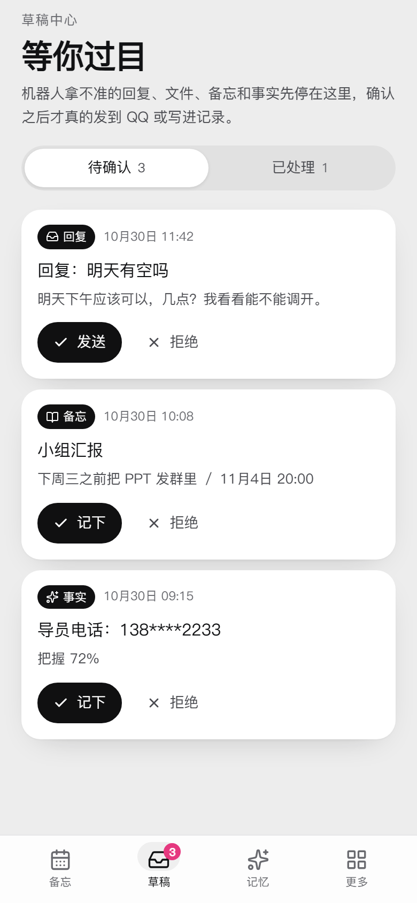

<div align="center">

# 值守台 · QQ 消息智能助手

**把群里的「下周三交表」「周四晚七点班会」自动变成会按时找你的提醒**

[]()
[]()
[]()
[]()
[]()
[]()

[解决什么问题](#-解决什么问题) · [核心功能](#-核心功能备忘与分级提醒) · [系统架构](#-系统架构) · [数据模型](#-数据模型) · [技术栈](#-技术栈) · [快速开始](#-快速开始)

</div>

---

## 💡 解决什么问题

信息是在 QQ 里被动出现的，而待办工具需要你主动打开、主动录入——多这一步，就少记一次。

| 痛点 | 现实情况 |
|---|---|
| **通知会沉底** | 班会改时间、面试确认、缴费截止都散在群聊里，看完就翻不到了，靠脑子记必然漏 |
| **入口是错的** | 日历、待办 App 要你主动打开再手打一遍；而信息就在 QQ 里，复制粘贴都嫌麻烦 |
| **全提醒 = 没提醒** | 什么都要提醒，等于什么都会被忽略；全靠人判断轻重，等于不会用 |
| **交给大模型记并不可靠** | 纯 Prompt 方案没有状态、没有幂等、没有审计：会忘、会重复推、会把「室友的学号」记成你的 |

**这个项目的分工是**：大模型只回答「这条消息里有没有事、是什么事、有多重要」，工程代码负责「什么时候提醒、提醒几次、发没发出去、有没有重复」。
两者用一张状态机表和一份接口契约隔开，谁也不越界。

结果就是三件事：**不漏**（分级提醒 + 双端闭环）、**可控**（所有 AI 判断都能降级成草稿让人过一眼）、**可查**（12 张表 + 全链路消息日志）。

---

## ⭐ 核心功能：四件事

一条流水线：**消息进来 → 该记的记下 → 该说的说 → 没看到的补给你 → 想问什么就问。**

| 功能 | 一句话 | 状态 |
|---|---|---|
| **F1 备忘与分级提醒** | 从群聊和私聊里抽出「要做什么、什么时候」，按重要性决定提醒几次 | 可用 |
| **F2 自动回复** | 替你说日常话：你的风格 + 你写的额外要求 + 最近 15 条上下文；按群开关、每小时限额、拿不准先存草稿 | 代码就绪，需重新导入 Dify Chatflow 后生效 |
| **F3 消息整理推送** | 你不在的时候群里发生了什么，按你关心的程度排好，重要的一条弹一次 | 可用 |
| **F4 历史消息查询** | 「小明的生日是什么时候」→ 结论 + 2–3 条原文证据；认不出人时反问你 | 可用 |

四件事共用同一套地基：一条 `message_log`（进和出都记）、一个草稿中心（AI 可能出错的地方都能降级成"等你点确认"），以及一条硬规矩——**AI 只做判断，执行交给确定性的代码**。

### F1 · 备忘与分级提醒

这是项目的主线，其余能力都是它的延伸。

#### 1. 消息进来就自动成条

在 QQ 里说一句「周四晚上七点班会，线上腾讯会议」，助手会抽出标题、时间、分类，并**给这件事打 1–5 级重要性**：

| 级别 | 判定 | 例子 |
|---|---|---|
| 5 紧要 | 有明确时间 + 错过后果严重 | 考试、面试、答辩 |
| 4 重要 | 有明确时间 + 重要但可调整 | 重要邀约、缴费截止 |
| 3 一般 | 普通邀约 / 一般截止 | 班会、聚餐 |
| 2 轻量 | 低价值待办 | 帮室友带东西 |
| 1 存档 | 纯信息，无行动项 | 通知存档 |

#### 2. 重要性决定提醒密度，不是一刀切

| 级别 | 提前量 | 次数 | 语气 |
|---|---|---|---|
| 5 | 24h / 2h / 30min | 3 次 | 强 |
| 4 | 24h / 1h | 2 次 | 较强 |
| 3 | 2h | 1 次 | 温和 |
| 2 | 当天 09:00 | 1 次 | 轻 |
| 1 | 不提醒 | 0 | 静默 |

每条提醒在 `memo_reminder` 里是**独立一行**，有独立的发送状态。改重要性或改时间时，旧档位作废保留（审计用），按新档位重排——不会出现「改了时间却还在按老时间推」。

#### 3. 三个入口，一个出口

- **QQ 里说一句** → Dify 抽取 → 入库
- **QQ 里改一句** → 「班会改到后天 4 点」「班会取消了」作用在**同一条**备忘上：Dify 通过 `POST /api/agent/ops` 发起窄写操作（改哪条、改什么由它判断），校验、归属、状态迁移、提醒重算、幂等、审计留在 Spring。改完能在详情页的「变更记录」里看到改前改后
- **网页里手写** → 移动端时间轴直接新建
- **AI 拿不准时** → 降级成 `MEMO` 草稿，你在草稿中心点一下才入库（时间说不清、要素缺失时不会瞎猜）

#### 4. 双端闭环

提醒发出后，你在 QQ 里回「做完了」就行；也可以打开网页勾掉那条。
状态机：`ACTIVE → REMINDED → AWAITING_REPLY → DONE | CANCELLED`，另有 `OVERDUE` 单独标记逾期。两边改的是同一行数据。

#### 5. 网页端是「值日表」

备忘页是一条时间轴：左边勾选圆点、中间卡片、右边时间，滚过当前时刻有一条「现在」线；**接下来这一件**用深色卡单独拎出来。

<div align="center">



</div>

---

### F2 · 自动回复

替你说日常话，但**只替你说该说的话**。开口要过三道关：

1. **会话开关**：`chat_setting.auto_reply_enabled`，按群 / 按私聊单独开。关着不影响别的功能——
   备忘照建、查询照答，只是不替你说闲聊。
2. **每小时限额**：`app_setting.reply_rate_limit`（默认 20），超了就只做事、不说话。
3. **拿不准就交给你**：回复信封带 `needs_confirm`，涉及替你承诺、定时间、谈钱、被点名表态时，
   不直发，而是落成 `draft(type=REPLY)`，你在草稿中心点一下才发。

注入给模型的三份材料，优先级从高到低：**固定约束**（不透露是机器人、不替你承诺、不编造）→
**你写的额外要求**（设置页那段多行文本，比如"语气随意点""别提我工作"）→ **最近 15 条消息**
（它得知道刚才在聊什么，不能只看见被 @ 的那一句）。风格画像只决定「怎么说话」，不是内容来源。

> 另外还有一条前置拦截（关键词 + 正则，报学号这类固定回复）：直接绕过模型省 token，
> 但仍先查防重表，同一个收集任务只回一次。

### F3 · 消息整理推送

打开网页，首页顶部一张「你不在的这段时间」卡片：按重要度倒序，默认折叠到 5 条；
有 4 级以上（含）的条目才弹窗，同一时间段只弹一次。底部点「都在这里了」记下时间点
（存在服务端，换设备不会重复推）。

只整理你在「群设置」里勾了的群，**私聊不整理**。候选先由规则层筛（@ 了我、出现我的称呼、
带时间词、带文件、来自重要联系人），再由模型合成 1–5 级重要度，注入你写的「关注点」
（比如"我关心实习招聘和课程通知，游戏群谁赢谁输不用告诉我"）。

防幻觉是硬校验不是提示词自觉：模型给的 `source_msg_ids` 必须在输入里真实存在，否则整条丢弃。

### F4 · 历史消息查询

`/ask` 页面一个对话框。问「我的同学小明的生日是什么时候」，它答结论 + 2–3 条原文证据。
认不出「小明」是谁时**反问**，你答完（"就是三班群里那个"）它记住关系，再接着答原问题。

背后不是纯向量检索：每晚把新消息抽成「谁 · 什么属性 · 什么值 · 出处」，查的时候先认人、
再取候选集、再生成，最后校验引用的 id 是否都在候选集里——不在就只给证据、不给结论。
个人 QQ 的数据量下，这样比向量检索准，还能给出处。

---

### 🧊 文件填写（冻结）

收到 xlsx / docx 后，模型只决定「哪个单元格填什么」，Python 侧机械地读写；缺字段就追问，
置信度不够就转成文件草稿。Chatflow 已搭、部分节点待修，**本轮不碰**。

---

## 🏗️ 系统架构

```
QQ 客户端
   │ QQ 协议
NapCat ──► LangBot + qq_assistant_plugin（路由 / 拦截 / 拟人延迟 / 文件 IO）
              │                    │
              │ 语义与决策          │ 状态、持久化、调度
              ▼                    ▼
           Dify Chatflow      Spring Boot ──► MySQL
              │                    │
              └── 决策 envelope ───┘        REST
                                           ▼
                                    Vue3「值守台」（移动端）
Spring Boot ──► send_bridge ──► LangBot / NapCat（主动发文本、发文件）
```

### 职责红线（四条，不可越）

| 红线 | 为什么 |
|---|---|
| 业务逻辑不写进 Dify Prompt | 状态机、持久化、定时调度放 Prompt 里就没法测、没法查、没法回滚 |
| Dify 不碰文件流 | 模型只接收结构化后的表格摘要，二进制读写归 Python |
| 风格记忆不许实时改 System Prompt | 每句话都改 prompt 必然漂移；风格只允许定期离线总结后整体替换 |
| Spring Boot 不直连 NapCat | 所有 QQ 动作经 LangBot / 发送桥，协议细节不进业务层 |

### 一次提醒的完整链路

```
QQ 消息 ─► 插件归一化 ─► Dify 抽取(title/dueTime/importance)
                              │ 置信度够
                              ▼
                     Spring Boot 入库 + 按级别展开 memo_reminder
                              │
              Spring @Scheduled 每分钟扫到期 ─► send_bridge ─► LangBot ─► 你的 QQ
                              │
                     回「做完了」─► 插件识别 ─► PATCH 状态 ─► 未发的提醒全部作废
```

---

## 🗄️ 数据模型

12 张表，**只有 Spring Boot 直连数据库**；插件和前端都走 REST，所以下表的「谁写 / 谁读」指的是实际发起方。
唯一的例外是 `file_task`——它的状态机真身在插件里，Spring 这边只是只读镜像。

| 表 | 用途 | 谁写 | 谁读 |
|---|---|---|---|
| `memo` | 备忘主体（标题/时间/重要性/分类/状态） | Spring（含 Dify 经 `/api/agent/ops` 发起的改动） | Vue / 调度 |
| `memo_reminder` | 提醒计划，按级别展开成多行 | Spring | 调度 / Vue |
| `memo_change_log` | 备忘改动留痕（改前/改后快照 + `eventId` 幂等键） | Spring | Vue |
| `draft` | 统一草稿中心（REPLY/FILE/MEMO/FACT 四类共用一张表） | Dify / 插件 | Vue |
| `message_log` | 全链路消息流水（IN/OUT + 去重键） | 插件 / 发送桥 | Vue / 风格总结 |
| `profile_fact` | 事实记忆 kv（学号、姓名、专业…） | Dify / Vue | Dify |
| `style_profile` | 风格画像正文 | 定期总结任务 / Vue | Dify |
| `intercept_rule` | 前置拦截规则（关键词 + 正则，60s 热更新） | Vue | 插件 |
| `collection_task` | 防重状态（chat + taskType + 时间窗口） | 插件 / Dify | 插件 |
| `file_task` | 文件任务状态镜像 | 插件同步 | Vue |
| `conversation_session` | QQ 会话 ↔ Dify conversation_id | 插件 | 插件 |
| `app_setting` | 全局配置 kv | Vue | 全部 |

设计上有一个刻意的取舍：**草稿只有一张表**。回复、文件、备忘、事实四种「待人工确认」的东西共用 `draft`，靠 `type` 区分、靠 `payload` 承载各自结构。确认接口按 type 分发——这比四套平行的待办表省掉了四份重复代码。

---

## 🧱 技术栈

| 层 | 选型 | 说明 |
|---|---|---|
| 前端 | Vue 3 + TypeScript + Vite | 零 UI 库，样式全自主；移动端优先，宽屏居中成手机画布 |
| 业务后端 | Java 21 + Spring Boot 3.4 + MyBatis-Plus | 状态机、持久化、`@Scheduled` 提醒扫描、REST |
| 协议接入 | NapCat + LangBot | QQ 协议、消息/文件收发 |
| 插件 | Python 3.12 | 前置拦截、拟人延迟、文件读写、会话映射 |
| 发送桥 | Python（FastAPI） | 主动发文本/发文件，`bizRef` 幂等，绝不自动重试 |
| 编排 | Dify Chatflow | 意图识别、抽取、决策 envelope |
| 数据库 | MySQL 8（utf8mb4） | 12 张表 |

---

## 🚀 快速开始

**前置**：一台能跑 Docker 的 Linux（NapCat + LangBot + 发送桥）、一个 QQ 小号、一个 Dify 应用、MySQL 8。

```bash
# 1) 数据库
mysql -u root -p -e "CREATE DATABASE qq_assistant DEFAULT CHARSET utf8mb4;"
# 建表脚本见 design/database_schema.md

# 2) QQ 侧（NapCat + LangBot + 发送桥）
cd deploy
cp .env.example .env      # 填 QQ 号、LangBot Key、桥的地址
docker compose up -d

# 3) 业务后端
cd ../QQMessageAssistantJava
# 改 application.yaml 里的 datasource 与 langbot.base-url
mvn spring-boot:run        # 默认 8080

# 4) 前端
cd ../QQMessageAssistantVue
npm install
npm run dev                # 5173，/api 代理到 8080
```

**第一次用**：打开网页 → 「更多 → 设置」→ 填自己的 QQ 号并保存。后端用它判断哪些备忘、事实、草稿属于你。

细节见 [`deploy/README.md`](./deploy/README.md)。

---

## 📁 目录结构

```
.
├── QQMessageAssistantJava/      # Spring Boot：状态机 / 持久化 / 调度 / REST
│   └── src/main/java/com/czx/qqmessageassistantjava/
│       ├── controller/ service/ mapper/ entity/ dto/ vo/
│       ├── schedule/            # @Scheduled 提醒扫描
│       └── client/              # 调发送桥
├── QQMessageAssistantPython/
│   ├── qq_assistant_plugin/     # LangBot 插件：路由 / 拦截 / 拟人 / 文件 IO
│   └── send_bridge/             # 主动发送桥（幂等、不重试）
├── QQMessageAssistantVue/       # 值守台（移动端 Web）
│   └── design/preview/          # 界面截图
├── design/                      # 架构 / 需求 / 接口契约 / 表结构 / Chatflow
└── deploy/                      # docker-compose 与部署手册
```

---

## 📌 当前状态

代码基本跑通，**真机验收还在进行**，如实标注：

| 模块 | 代码 | 备注 |
|---|---|---|
| F1 备忘与分级提醒 | ✅ | 调度默认关闭，需显式开启 |
| F2 自动回复 | 🟡 | 插件门控、`reply-context` 接口、设置页都已就绪；**需把 `design/QQAssistant.chatflow.yml` 重新导入 Dify 并发布**才生效 |
| F3 消息整理推送 | ✅ | 每小时任务；只看你勾了的群 |
| F4 历史消息查询 | ✅ | 反问闭环 + 证据校验 |
| 草稿中心 | ✅ | 四类草稿确认/拒绝均可用 |
| 消息日志 | ✅ | 已真机验收 |
| 记忆（事实） | ✅ | 增删改查 + 网页兜底 |
| 记忆（风格总结） | 🟡 | 定时任务待接 |
| 前置拦截 / 防重 | ✅ | 拦截规则可在网页改，60s 生效 |
| 文件填写 | 🧊 | 冻结，本轮不动 |
| 前端 11 页 | ✅ | 首页 / 备忘 / 草稿 / 记忆 / 问答 / 更多 / 文件任务 / 消息日志 / 拦截规则 / 群设置 / 设置 |

**已知限制**：单实例、单主人、内网运行，无鉴权、无分页、无多租户——这是刻意的，个人工具不需要这些。

---

## 📚 文档

| 文档 | 内容 |
|---|---|
| [`design/requirements.md`](./design/requirements.md) | 需求规格（FR / NFR / 验收标准） |
| [`design/architecture.md`](./design/architecture.md) | 分层架构与三个全局抽象 |
| [`design/api_contract.md`](./design/api_contract.md) | 31 个对外端点的契约 |
| [`design/database_schema.md`](./design/database_schema.md) | 12 张表的字段级设计 |
| [`design/agent_contract.md`](./design/agent_contract.md) | Dify ↔ 插件的决策 envelope |
| [`design/dify_chatflow.md`](./design/dify_chatflow.md) | Chatflow 节点图与变量约定 |
| [`deploy/README.md`](./deploy/README.md) | 部署、备份与故障排查 |

---

<div align="center">

个人项目，跑在自己的机器上，聊天数据不出内网。

</div>
