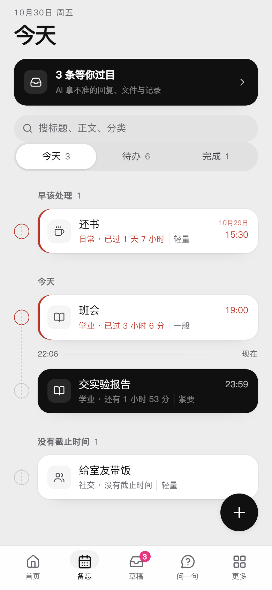
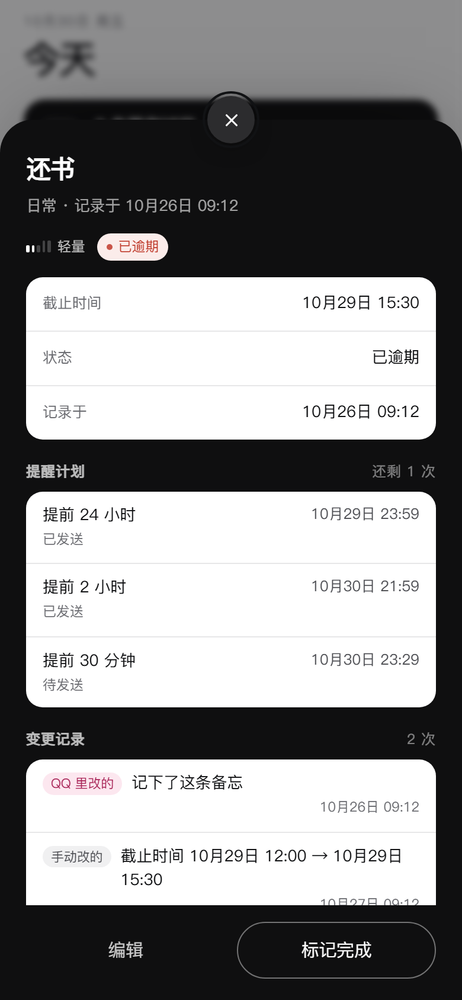
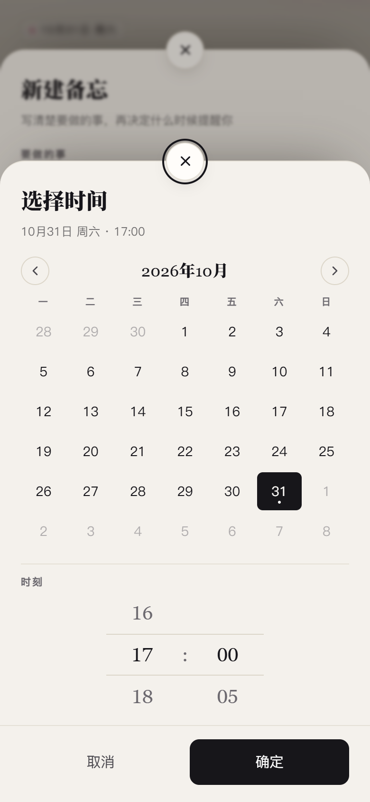
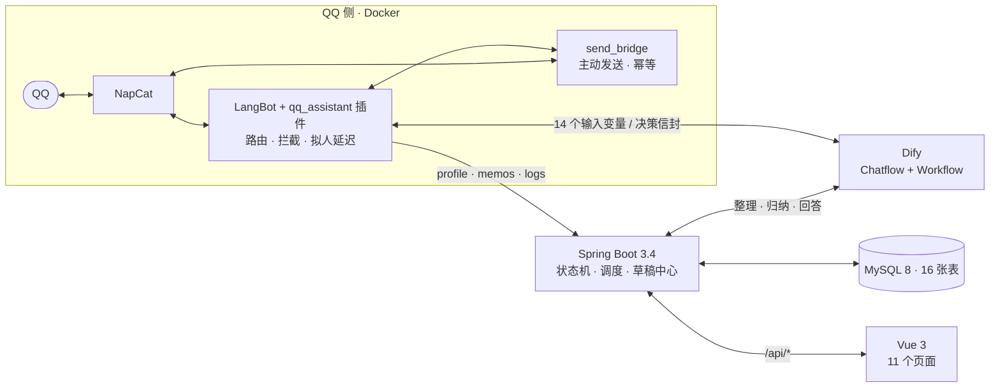

<div align="center">

# 值守台

**一个替你看着 QQ 的私人助手**

群里的「下周三交表」「周四晚七点班会」它记下来、到点提醒你；
你不在的时候群里聊了什么，打开网页就知道；想问「上次谁说的实验报告几号交」，一句话就能翻回去。

<sub>Spring Boot · Vue 3 · LangBot 插件 · Dify · MySQL —— 单机、单用户、全本地</sub>


[它做什么](#它做什么) · [四个功能](#四个功能) · [架构](#架构) · [工程取舍](#几处刻意的工程取舍) · [数据](#数据模型) · [跑起来](#本地跑起来) · [目录](#仓库结构) · [文档](#设计文档)

</div>

---

<p align="center">
  
  
  
</p>

<p align="center"><sub>备忘时间线 · 详情抽屉 · 自绘的日期时间选择器（390dp，真机截图）</sub></p>

## 它做什么

信息是被动出现在 QQ 里的，而待办工具要你主动打开、主动录入——多这一步，就少记一次。这个项目的做法是：**把 QQ 本身当成入口**，机器人待在群里，用大模型判断语义，用工程代码管状态。

| 你遇到的麻烦 | 它的处理 |
| --- | --- |
| 通知看完就沉底，靠脑子记必然漏 | 群里带时间的事自动抽成备忘，按重要性分级提醒，到点在 QQ 里戳你 |
| 什么都要提醒，等于什么都没提醒 | 五级 rubric + 分级提前量，5 级连催三次、1 级静默存档 |
| 离开半天，回来要爬几百条楼 | 每小时把勾选的群整理成要点，「要你拿主意」的排最前面 |
| 想找一句话，只记得大概意思 | 一句话提问，答案必须附原文证据；认不出「小明」是谁就反问 |
| 纯 Prompt 方案会忘、会重复、会记错人 | 状态机、幂等键、证据校验全在代码里，AI 只负责语义 |

## 四个功能

| # | 功能 | 现在的样子 |
| --- | --- | --- |
| **F1** | **备忘与分级提醒** | 从消息里抽 `title / dueTime / importance(1-5) / category`，按级别展开成多条提醒；QQ 里回「做完了」即闭环；每次改动留痕 |
| **F2** | **拟人回复** | 私聊按 `1.5s + 字数×0.15s + 抖动` 延迟发送，语气来自「事实记忆 + 风格画像」；拿不准就降级成草稿，绝不乱发 |
| **F3** | **消息整理** | 每小时按群切段交给 Dify 提炼要点，Spring 校验证据 id 后落库；首页只显示你勾过的群 |
| **F4** | **历史查询** | 每天 0:10 把当天消息抽成 `contact` / `memory_note`；提问时先认人（0 条=不认识，≥2 条=冲突，都转反问），再带证据作答 |

> **已冻结**：表格自动填写（xlsx/docx 读写）跑通过，但模板千奇百怪，投入产出不划算。代码保留在 `file_task` 与插件里，不再迭代。

## 架构



| 组件 | 只管 | 绝不管 |
| --- | --- | --- |
| **NapCat** | QQ 协议、收发消息与文件 | 任何业务判断 |
| **LangBot 插件** | 事件归一化、群触发判定、正则拦截、拟人延迟、文件 IO、动作执行、幂等 | 长期状态、定时任务 |
| **Dify** | 意图识别、对话状态、语义生成、决策信封 | 持久化、文件流、定时 |
| **Spring Boot** | 16 张表的持久化、提醒调度、草稿分发、画像存取 | 文件流、直连 QQ |
| **Vue** | 展示、人工确认、手动编辑 | 业务判定 |

**四条不能越的线**（评审按这四条判）：

1. 业务逻辑不进 Dify 提示词——阈值、状态迁移、提醒策略只写在 Java 服务层；
2. Dify 不接触文件流——插件解析成结构再送，Dify 只回「填什么到哪」；
3. 风格画像不由单条消息实时改写——只有定期总结能更新它，事实记忆才可以实时写；
4. Spring 不直连 NapCat——一切 QQ 动作经插件或发送桥。

## 几处刻意的工程取舍

这些不是顺手的实现细节，是踩过坑之后定下来的规则。

**AI 的每个产出都可降级。** Dify 返回的 Answer 必须是纯 JSON 决策信封，动作只有 `SEND / DRAFT / SILENT / MEMO / FACT / MEMO_CLOSE / WAIT_FILE / ASK / FILE_FILL`。解析失败、字段缺失、动作未知——一律当 `SILENT` 记日志，**绝不把模型原文发给用户**。四类草稿（回复/文件/备忘/事实）共用一张表，`PENDING` 永不过期。

**所有对外副作用都有幂等键。** 主动发送用 `bizRef`（在途返 409、重试返首次的 `messageId`，状态落盘，重启不丢）；群内防重用 `task_key = chat_id + 类型 + 时间窗口`；消息记账用 `dedupe_key`。重复投递、重复确认、服务重启，都不会重复发一条。

**答案必须带得回原文。** 整理结果带 `source_msg_ids`，查证结果带 `used_ids`，对不上候选集就整项丢弃或降级成「只给证据」。宁可少说一句，不可编一句。

**拟人延迟是有公式的，不是随手 sleep。** `1.5s + 字数 × 0.15s + 抖动(0~1s)`，上限 15s，四个参数都可配；只对私聊生效，群里不装人。Java 侧读超时必须大于「15s 延迟 + 10s HTTP」的 25s，否则会出现「Java 已回滚、桥仍发出」的重复发送。

**发送是两份契约，不是一份。** `send_message`（文本）与 `send_file`（二进制）分开，永不混用；文件通道在 LangBot 不支持时回落 NapCat。

## 数据模型

16 张表，全部 `utf8mb4`，DDL 见 [`db/schema.sql`](QQMessageAssistantJava/src/main/resources/db/schema.sql)，增量脚本在 `db/migrations/`。

| 域 | 表 |
| --- | --- |
| 消息与会话 | `message_log`（唯一事实源，带昵称与群名）、`conversation_session`（QQ 会话 ↔ Dify `conversation_id`） |
| 备忘 | `memo`、`memo_reminder`（按级别展开为多行）、`memo_change_log` |
| 草稿 | `draft`（`REPLY / FILE / MEMO / FACT` 四类共用） |
| 群与规则 | `chat_setting`、`intercept_rule`、`collection_task`（防重状态） |
| 记忆 | `profile_fact`（事实 kv）、`style_profile`（画像，保留历史版本）、`contact`（人物别名）、`memory_note`（夜间归纳） |
| 整理 | `chat_digest_item`（要点 + 证据 id） |
| 文件 | `file_task`（插件状态机的只读镜像） |
| 配置 | `app_setting` |

**状态真身与镜像**：文件任务的状态机活在插件里，Spring 只存镜像供前端读；会话映射有三层兜底（内存 → Spring → 本地 JSON）。

## 技术栈

| 层 | 选型 | 备注 |
| --- | --- | --- |
| 前端 | Vue 3.5 + TypeScript + Vite | `<script setup>`，**零 UI 库**，390dp 画布优先，11 条路由全部懒加载 |
| 后端 | Java 21 + Spring Boot 3.4.12 | MyBatis-Plus 3.5.9、RestClient、springdoc；16 个控制器 / 47 个端点 |
| 插件 | Python 3.12 + httpx | LangBot 插件形态，`openpyxl` / `python-docx` / `pypdf` 做文件 IO |
| 发送桥 | Python 3.12 + FastAPI | 单职责：把「发文本 / 发文件」做成幂等 HTTP 接口 |
| 编排 | Dify Chatflow + Workflow | 一份对话流做决策，一份「记忆与整理」做整理 / 归纳 / 回答；两份 DSL 已入库 |
| 存储 | MySQL 8 | 单库单实例，时间由 Java 写本地时间（那台库跑 UTC） |
| 部署 | Docker Compose | LangBot / 插件运行时 / NapCat / 发送桥，四个容器 |

测试：Java 28 个测试类（`mvn test`），Python 177 个用例（插件 146 + 发送桥 31，`pytest`）。

## 本地跑起来

### 0. 前置

Java 21、Maven、Node 20+、MySQL 8、Docker。Dify 与 NapCat 各需一份可用实例。

### 1. 建库

```bash
mysql -uroot -p -e "CREATE DATABASE qq_assistant DEFAULT CHARACTER SET utf8mb4 COLLATE utf8mb4_0900_ai_ci;"
mysql -uroot -p qq_assistant < QQMessageAssistantJava/src/main/resources/db/schema.sql
```

已有库升级：按文件名顺序执行 `db/migrations/*.sql`，不要重建。

### 2. 后端（:8080）

改 `QQMessageAssistantJava/src/main/resources/application.yaml` 里的 `spring.datasource` 与 `langbot.base-url`，然后：

```bash
cd QQMessageAssistantJava
export AGENT_OPS_TOKEN=$(openssl rand -hex 16)   # Dify 回写用的令牌，留空则该入口整体 503
mvn spring-boot:run
```

接口文档：<http://localhost:8080/swagger-ui/index.html>。统一响应体 `{code, message, data}`，`code == 0` 才算成功。

### 3. 前端（:5173）

```bash
cd QQMessageAssistantVue
npm install
npm run dev        # /api 代理到 http://localhost:8080
```

后端不在本机就设 `VITE_API_TARGET`。打包：`npm run build`（`vue-tsc -b && vite build`，零错误才算过）。

### 4. QQ 侧

```bash
cd deploy
cp .env.example .env      # 填 NAPCAT_WEBUI_TOKEN / NAPCAT_UID / NAPCAT_GID / SPRING_BASE
docker compose up -d
```

接着四步：NapCat 扫码登录 → LangBot 里建机器人拿 `UUID` / `API Key` → 安装 `qq_assistant_plugin` 并填参数 → Dify 导入 [`QQAssistant.chatflow.yml`](design/QQAssistant.chatflow.yml) 与 [`QQAssistant-memory-workflow.yml`](design/QQAssistant-memory-workflow.yml)。

发送桥的环境变量：

| 变量 | 用途 |
| --- | --- |
| `LANGBOT_BOT_UUID` / `LANGBOT_API_KEY` | 主动发消息的身份 |
| `SPRING_BASE` | 回查发送记录 |
| `NAPCAT_BASE` / `NAPCAT_TOKEN` | 文件通道回落 |
| `DELAY_BASE_MS` / `DELAY_PER_CHAR_MS` / `DELAY_JITTER_MS` / `DELAY_MAX_MS` | 拟人延迟四参数 |
| `STATE_FILE` / `IDEMPOTENCY_TTL` | 幂等状态落盘位置与有效期 |

完整步骤、地址对照表、排错对照表在 [`deploy/README.md`](deploy/README.md)。

> 密钥、Token、数据库口令一律走环境变量或 `.env`，**不要**写进 `application.yaml` 再提交。

## 仓库结构

```
.
├── QQMessageAssistantJava/       Spring Boot：16 控制器 / 47 端点 / 16 表 / 28 测试类
│   └── src/main/resources/db/    schema.sql 与增量 migrations
├── QQMessageAssistantPython/
│   ├── qq_assistant_plugin/      LangBot 插件：事件、拦截、文件 IO、决策执行、幂等
│   └── send_bridge/              主动发送桥：幂等 + 拟人延迟 + 文件通道
├── QQMessageAssistantVue/        Vue 3 前端：11 页，无 UI 库
│   └── design/preview/           设计预览图（真机尺寸）
├── deploy/                       docker-compose.yml + .env.example + 部署手册
└── design/                       设计文档（准据）与两份 Dify DSL
```

## 设计文档

先读文档再读代码——字段、契约、状态机都在里面。

| 文档 | 内容 |
| --- | --- |
| [`requirements.md`](design/requirements.md) | 需求规格：用例、功能编号、验收标准、实现进度 |
| [`architecture.md`](design/architecture.md) | 组件边界与四条红线 |
| [`api_contract.md`](design/api_contract.md) | Spring 对外接口逐字段契约 |
| [`agent_contract.md`](design/agent_contract.md) | Dify ↔ 插件的信封协议与 `agent/ops` 窄写接口 |
| [`database_schema.md`](design/database_schema.md) | 16 张表的字段级说明 |
| [`dify_chatflow.md`](design/dify_chatflow.md) | Chatflow 节点图与已知坑 |
| [`memory_workflow.md`](design/memory_workflow.md) | 夜间归纳与风格总结的调度 |
| [`core_features.md`](design/core_features.md) | F1–F4 的重新定义与取舍 |

## 项目状态

| 部分 | 状态 |
| --- | --- |
| 后端 / 插件 / 发送桥 | ✅ 可用，测试全绿 |
| Dify 对话流 | ✅ 可用（DSL 已入库，导入后需重填密钥） |
| Vue 前端 | ✅ 11 页，390 / 360 / 1280 三档验过 |
| 真机全链路验收 | 🟡 按 UC 逐条在跑，尚未全绿 |
| 表格自动填写 | 🧊 冻结 |

**已知限制**：单用户单实例，无鉴权、无分页，只在内网跑；整理与夜间归纳的调度默认关闭，需在 `app_setting` 里打开 `digest_enabled` / `memory_job_enabled`；PDF 只读不回写；群聊不共享上下文（每个群成员独立会话）。

## 声明

个人自用项目，与腾讯及 QQ 官方无关；QQ 登录态与聊天数据只存本地，备份不外发。运行所需凭据（Dify Key、`AGENT_OPS_TOKEN`、数据库口令）请自行配置，不要提交进仓库。
